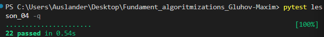

# Домашняя работа № 4 · Две задачи на изученные приёмы

**Дисциплина:** ОП.04 «Основы алгоритмизации и программирования»

| Поле | Значение |
|---|---|
| Фамилия, имя, отчество | Глухов Максим Иванович |
| Группа | РПО-24/9/3 |
| Номер работы | 4 |
| Тема работы | Лодки на сплаве и «сначала чётные»: выбор приёма |
| Дата сдачи | 12.10 |
| Ветка | `hw-04` |

Текст ниже уже написан. Замените `___` своими данными, в строках с вариантами
оставьте нужный и вставьте кадр вместо строки «Скриншот: …».

Приёмы на выбор: указатели навстречу · указатели в одну сторону ·
разделение на две группы.

---

## 1. Лодки на сплаве

Я отсортировал копию списка весов и решил задачу приёмом двух указателей, движущихся навстречу друг другу.
Время решения — O(n log n), дополнительная память — O(n).

## 2. Сначала чётные

Я переставил числа внутри `nums` приёмом разделения на две группы с помощью двух указателей. Один указатель движется слева направо в поиске нечётного числа, другой — справа налево в поиске чётного. Найденные числа меняются местами. Новых списков не создавал.
Время решения — O(n), дополнительная память — O(1).

## 3. Проверка

Команда `pytest lesson_04 -q` показала: `22 passed`.

Скриншот: вставьте строку ``

22 passed in 0.54s
---

Не получилось (если всё работает, оставьте пустым): ___

ИИ: использовал для оформления отчёта.
